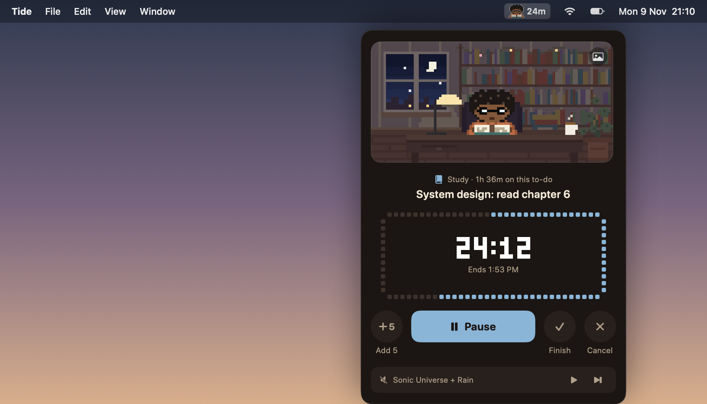

<div align="center">

# Plain

**A cozy focus timer that lives in your menu bar, with a little pixel friend who works when you do.**




</div>

## Features

- **Wren in the menu bar.** An original pixel character (afro, thick glasses, terracotta hoodie) who types, reads, scribbles, sips tea, nods along to music or dozes, depending on what you're doing. Drawn in code, crisp at any size, a few frames a second, paused while the screen sleeps, still under Reduce Motion.
- **Scenes that follow you.** A cozy room, a code den (when an editor or terminal is in front), a library (study) and a beach (breaks). Pick one or leave it on Auto.
- **The real sky.** The sun and moon sit where they really are: sunrise, golden hour, sunset and night follow the actual sun for your time zone's city (from `/usr/share/zoneinfo/zone.tab`, no location permission), and the moon shows its real phase. `Plain --sky` prints today's sunrise, sunset and moon.
- **Focus on Things 4 to-dos.** Each mode only offers to-dos from its own Things area (Work → “Work”, Study and Exam → “Learning”), one at a time as “Next up”, with the full list a click away. The search field searches all of Things with loose wording (“chem paper”, “email maya”, typos too). Time is logged on the to-do (`POST /v1/tasks/{id}/time`), and you can mark it done afterwards. Free-text sessions land as completed to-dos in a "Focus Log" area. Offline entries wait in a queue and retry.
- **Lock in.** One tap to focus with no to-do and no title, as a pomodoro or counting up. Wren puts his headphones on. It stays in Plain's stats as “Work · Lock in”; attach a to-do mid-session and the time goes onto it in Things.
- **Quick start, ⌃⌥F.** Type “Reading system design docs 40 min study” and go.
- **Time blocks.** “From 14:00 to 17:00” starts now or waits for the start time.
- **Sessions.** 25 / 40 / 50 / custom, pause, +5, finish early, cancel (a minute or more is still logged), optional Pomodoro breaks, a soft chime and a notification.
- **Pomodoro rounds.** Pick ×2, ×3 or ×4 and Plain loops: focus, a short break, the next round starts by itself, until the last one ends. Each round is logged on its own; the running screen shows “Round 2 of 4” and when the whole run ends. Skip a break to start the next round early, or end the run.
- **Sound in two layers.** SomaFM stations (jazz, soul, lounge, chill, retro) with play/pause and skip, plus generated ambience: rain, ocean, stream, fireplace, white, pink or brown noise. Fades in with a session and out at the end.
- **Plays nicely with Tide.** When Tide comes to the front, Plain asks “What are we doing?” (Studying, Exam practice, Flashcards, Just chilling). It never starts a pomodoro there: Tide already logs study, so Wren just joins in, and “Just chilling” counts up until you leave Tide for five minutes. Plain reads Tide's study data API (paste the token from Tide › Settings › Tools into Plain's Settings; it's kept in the Keychain) for today, the week, the streak, the last two weeks and the kinds of study, falling back to Tide's log file when Tide is closed.
- **Count-up tracker.** No timer, no chime: time counts up (↑12m in the menu bar) until you stop it.
- **App time.** A Screen Time-lite view of how long each app was in front today and this week, ignoring time away from the Mac. Local only; can be turned off.
- **Editor nudge.** After two minutes in a code editor, Plain quietly offers a work session.
- **Stats.** Today, this week by mode, a streak and recent sessions, kept in `~/Library/Application Support/Plain/`.
- **Dashboard.** A full window (Stats › Dashboard, or `plain://dashboard`) with Tide study and Plain focus together over 7, 30, 90 days or a year: totals against the previous period, minutes per day, kinds of study, the hours you work, notebooks, topics, answer accuracy and flashcards, focus by mode, apps in front and every session. It has a Dock icon only while it's open.
- **Links.** `plain://start?task=<things id>&title=…&minutes=40&category=study` starts a session (Things 4's “Focus in Plain” uses it).
- **Notch island (preview).** An optional Dynamic-Island-style pill around the notch; off by default.

## Install

```sh
git clone <this repo> plain && cd plain
./scripts/install.sh      # builds, copies to /Applications/Plain.app and opens it
```

Plain is a menu bar app (no Dock icon). Things 4 logging reads the token from `~/Library/Application Support/Things4/api.json`.

## Build

Needs the Xcode Command Line Tools (Swift 5.9+), no Xcode project.

```sh
./build.sh                      # universal build/Plain.app, ad-hoc signed
./scripts/package.sh 1.0.0      # build/Plain-1.0.0.dmg
build/Plain.app/Contents/MacOS/Plain --selftest          # parser, timer, stats, Things payloads, art
build/Plain.app/Contents/MacOS/Plain --snapshot out/     # renders the popover, scenes and island to PNGs
```
